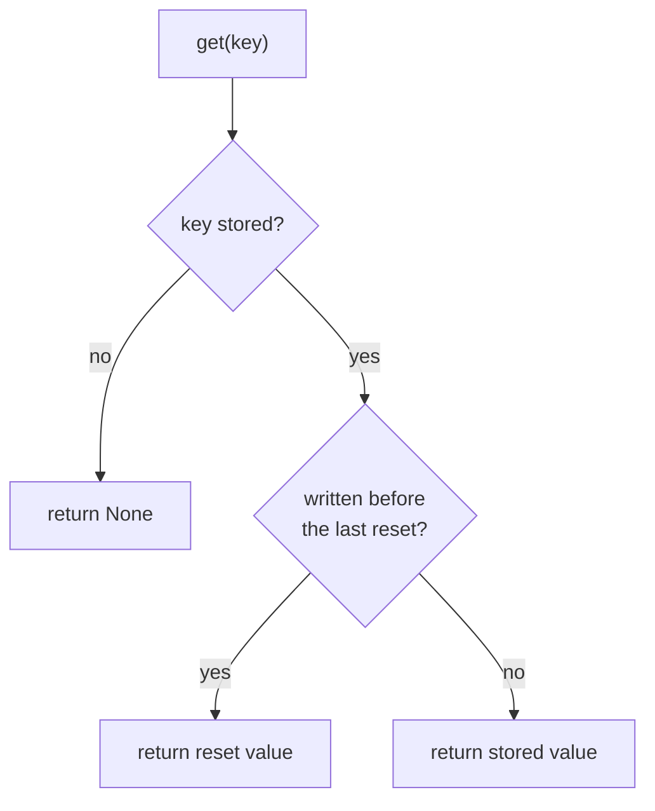
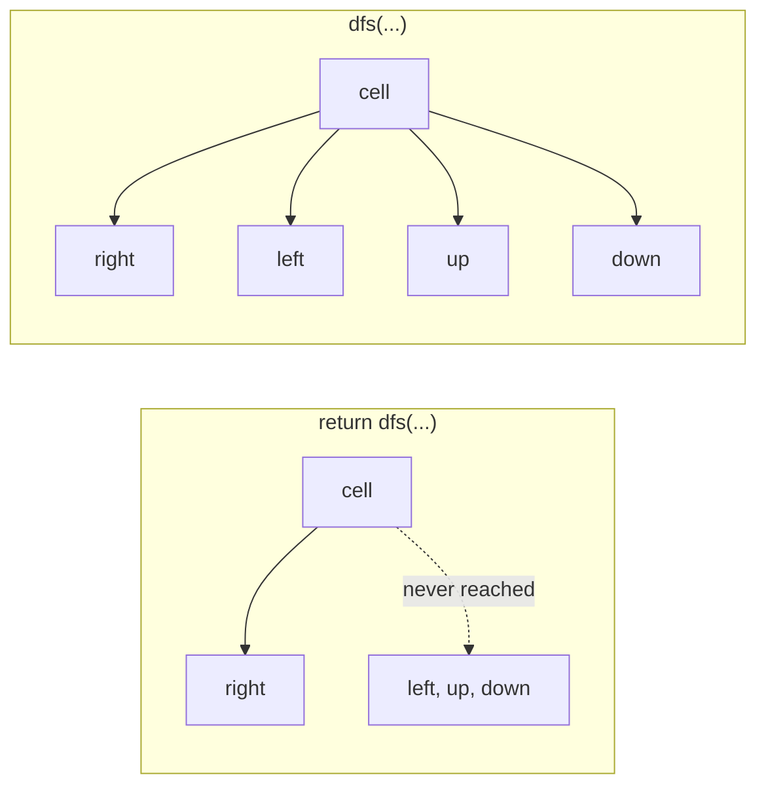
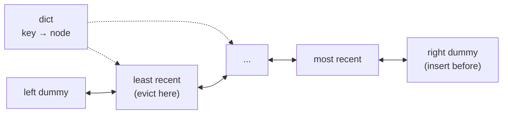

Captain's log, stardate 2026.298.

Two days back on LeetCode after a long time away. Twenty-odd problems in Python. I expected the algorithms to be the hard part. The hard part was my own habits.

## Small tools I didn't know I was missing

`dict.get(key, 0)` counts in one line without a `KeyError`. Dict keys must be hashable, so a sorted tuple works as a key where a list fails. That one idea is all of Group Anagrams. And a sliding window has to *shrink*. My first version rebuilt the whole set on every step, which is slower and still wrong.

## Hidden loops

The most useful lesson came from a quiz on time complexity, not from a problem. `list.remove`, `pop(0)` and `x in list` each walk the list. `s += c` in a loop copies the string every time. My "simple" cookie-matching solution was quietly O(m²) because of one `remove`. The rule I took away: count the work per item over the whole run, not how deep the loops are nested. Daily Temperatures has a `while` inside a `for` and is still O(n), because each index is pushed once and popped once.

## Don't do the work now

The design problems shared one trick. To reset every key in O(1), don't touch the keys. Record *when* the reset happened, and on each read check whether the key was written before or after it. Snapshot Array works the same way: store changes, not copies, and binary-search for the right version with `bisect`. Lazy turns out to be a strategy, not a vice.

## The bug that taught me recursion

My first grid DFS for Number of Islands wrote `return dfs(...)` inside the loop over four directions. It explored one direction and quit. The function only exists for its side effect, sinking land cells, so there is nothing to return. Delete one word and it works.

## Forget and rebuild

In the morning I built an LRU cache from a hashmap and a doubly linked list. By evening I had forgotten all of it. So I rebuilt it from the picture instead of from memory: a dict pointing at nodes, two dummy nodes at the ends, one helper to unlink a node and one to add it at the back.

Five bugs later the tests passed. The last one was subtle: updating a key that already existed left its old node in the list, and it crashed three operations later.

That rebuild taught me more than the first attempt did. Forgetting was the useful part.

Captain's log, supplemental. Next on the chart: topological sort, which I haven't touched yet, and re-solving these cold before they fade again.

End log.
