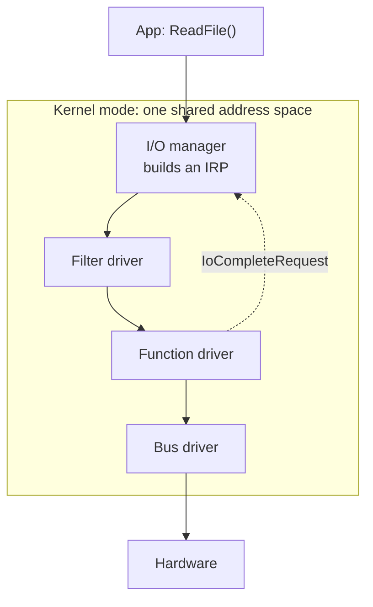

Captain's log, stardate 2026.307.

A few days away from Python. I took on two languages I read more than I write, and then went one level lower, to where the operating system meets the hardware.

## TypeScript: Python with a contract

Reading TypeScript was easier than I expected, because most of it maps straight across. A `dict` becomes a `Record` or a `Map`. `Optional[str]` becomes `name?: string`. A `Literal` becomes a union type: `type J = "CA" | "US"`. Two things caught me. Always use `===`, because `==` converts types before comparing. And an arrow function that returns an object needs parentheses, `(s) => ({ id: s.id })`, or the braces are read as a function body and it returns `undefined`.

## C++: who owns this memory?

Python hides one question that C++ asks on every line: who owns this, and when does it go away? Passing a `vector` by value copies all of it, so read-only inputs go in as `const T&`. A reference can't be null, but a pointer can, so a pointer always gets checked. RAII ties cleanup to scope: `unique_ptr` frees its memory when it leaves scope, and most leaks can't happen. Some small traps: `size()` is unsigned, so `size() - 1` on an empty vector wraps to a huge number. `stack.pop()` returns nothing. And `priority_queue` is a max-heap by default, the opposite of Python's `heapq`.

## Drivers: no safety net

Then I went down to drivers. A user-mode program that crashes takes only itself down. A kernel-mode driver shares one address space with the whole OS, so a bad pointer can corrupt anything. That's why Windows stops with a blue screen instead of running on in a corrupt state.

Every request travels as an I/O request packet (IRP), passed down a stack of drivers until one completes it. `DriverEntry` is the driver's `main`. The rule that surprised me most: at a high interrupt level the CPU can't wait for anything, including a page fault from disk. Data used there has to live in non-paged memory, or the machine bug-checks. Newer frameworks help. With UMDF a driver runs in user mode, so a crash takes down one host process instead of the system. Graphics drivers split the work the same way: a user-mode half turns Direct3D or Vulkan calls into GPU commands, and a kernel-mode half manages memory and scheduling. If the GPU hangs for about two seconds, Windows resets the driver instead of freezing.

`volatile` finally made sense here too. It doesn't make code thread-safe. It makes the compiler really perform every read of a hardware register, because the device can change that value without the program knowing.

Captain's log, supplemental. Each layer down has fewer guard rails. Next on the chart: write a small C++ program with a deliberate leak and find it with a sanitizer.

End log.
