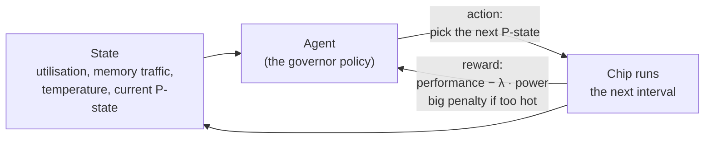

Captain's log, stardate 2026.308.

Tonight I went below the software, into the question every chip answers thousands of times a second: how fast should I run right now? Too fast and it burns power and heat for nothing. Too slow and the work waits. Something has to decide, and that something is called a governor.

## The power bill has a square in it

Most of the power a chip burns goes into switching transistors on and off. The formula for that is short:

`P_dyn = α · C · V² · f`

- **α** is the activity factor, the share of transistors switching each cycle. An idle block is near zero.
- **C** is the switched capacitance, fixed when the chip is designed.
- **V** is the supply voltage.
- **f** is the clock frequency.

The voltage is squared, and that changes everything. A faster clock usually needs a higher voltage to stay stable, so pushing frequency up costs close to the cube of the gain. It works the other way too. Drop the clock by 20% and the voltage by 10%, and dynamic power falls to 0.9² × 0.8 ≈ 0.65 of what it was. A fifth less speed buys a third less power.

There is a second, quieter bill: **leakage**. Transistors leak current even when nothing switches, and they leak more as they heat up. Heat causes leakage, leakage causes heat. Left alone, that loop runs away, which is why chips throttle themselves when they get too hot.

## The levers

Chips have a small set of controls for this, and each one targets a different term in the formula:

| Lever | What it does | What it cuts |
|---|---|---|
| **DVFS** (dynamic voltage and frequency scaling) | Moves between preset voltage/frequency pairs called P-states | V and f together |
| **C-states** | Idle sleep levels. Deeper sleep saves more but wakes slower | Almost everything, while idle |
| **Clock gating** | Stops the clock to an idle block | α, close to zero |
| **Power gating** | Cuts power to an idle block entirely | Leakage too, at the cost of a wake-up delay |

Even the obvious choice is not obvious. Sometimes the best way to save energy is to run *faster*: finish the job at high power, then drop into deep sleep. Energy is power multiplied by time, and a chip that leaks the whole time it is awake can come out ahead by sprinting. It stops working when the chip is waiting on memory, because running the core faster does not make the memory answer sooner.

## Why this is a reinforcement learning problem

A governor makes the same kind of decision over and over, sees what happened, and decides again. That is the exact shape of reinforcement learning.

- **State:** what the hardware counters say right now: how busy the cores are, how much memory traffic there is, the temperature, the current P-state.
- **Action:** choose the next P-state.
- **Reward:** performance minus a weighted power cost. Reward power alone and the agent learns to run the chip at minimum speed forever, which saves power and does nothing useful. The thermal limit goes in as a hard penalty, because breaking it is never worth the speed.

Hand-written governors use fixed rules: if utilisation is above a threshold, step up. They work, but the rules are tuned for typical workloads. A learned policy can pick up patterns a rule misses, like a workload that always spikes right after a quiet phase, and get ready for it.

## Why RL and hardware get along

Reinforcement learning is famous for being hungry. It needs millions of tries, and in most domains each try is expensive or dangerous. Hardware is unusually kind to it:

- **The feedback is fast and honest.** A decision every few milliseconds, and the counters report the result immediately. There is no waiting a week to see if the move was good.
- **The simulation is good.** Chip designers already have detailed power and performance simulators, so the agent can train in simulation before it ever touches silicon.
- **The action space is small.** A handful of P-states, not an endless space of choices.
- **The constraints are crisp.** Temperature and power limits are numbers, so they fit directly into the reward.

The catch is the step from simulation to silicon. A policy trained against a simulator learns the simulator's quirks, and real chips vary. The usual answer is to train in simulation, check against real measurements, and keep the deployed policy small enough to run inside the power manager without costing the power it is trying to save.

There is a sister problem on the design side. Those detailed simulators are slow, often hours per workload. A neural network trained on their output can predict power in milliseconds, so engineers can test thousands of design ideas instead of a few. The trap there is the split: hold out whole workloads for testing, not random slices of them, or the model memorises each workload and the score lies. And watch the peaks, not just the average error. A model that is right on average but misses the peaks is the one that lets the chip overheat.

Captain's log, supplemental. I once built a reinforcement learning agent for real-time cyber defence, and tonight the same loop showed up in a place I did not expect: state, action, reward, and a hard line you never cross. The difference is that here the reward is measured in watts. Next on the chart: build a toy version, a small simulator with a few P-states and a made-up workload, and see whether an agent can beat a simple threshold rule.

End log.
