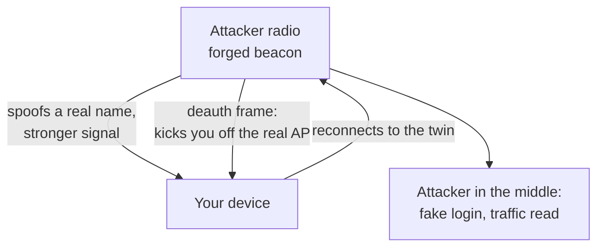

Captain's log, stardate 2026.308.

Tonight I flashed a ten-dollar yellow touchscreen into a radio scanner and pointed it at the air in my own home. I wanted to hear what the devices around me say out loud, without anyone asking them to.

## The air is talking

A phone or laptop that has ever joined a network keeps calling that network's name, hoping to hear it answer. These are probe requests, and anyone with a cheap radio can read them. Each one ties a device to a network it trusts:

- `DEVICE-A -> HOME-NET`
- `DEVICE-A -> (no name)`
- `DEVICE-B -> A-COFFEE-SHOP`

Read a few minutes of that and you have a map of where someone has been: home, work, the café they sit in. It is a quiet leak of history, broadcast for free.

The worst offender in the room was my own laptop. It was announcing the name of my home network and, worse, its real, permanent hardware address, the one number that marks that exact machine anywhere it travels. The fix took one setting: turn on randomized hardware addresses. Run the scan again and the laptop is gone, hidden behind a number that means nothing and changes often.

## The line

Listening costs nothing and touches no one. Every frame above was already in the air whether I caught it or not. Then I crossed to the other side, and transmitted.

There is a mode that forges networks that do not exist. I made a handful, a joke, the words of a certain song, one line per network. They appeared in the WiFi list of **every** device in range, not only mine. That is the line, and it is sharp. Listening is reconnaissance. Transmitting is an attack, because the air does not belong to me, and the forgery lands in my neighbours' phones as readily as my own.

## The twin

The joke and the real threat are the same trick. Instead of song lyrics, an attacker forges a beacon carrying a **real** name, a home network or a coffee-shop WiFi, at a stronger signal than the genuine one. A second forged frame knocks your device off the real access point. It reconnects to the twin, and now someone sits between you and the internet, serving a fake login page and reading what passes through.

The weakness underneath is small and old: a beacon is never signed. Nothing proves a network name belongs to the radio sending it, so your device trusts the loudest voice claiming a name it knows.

## Keeping the shields up

- **WPA3, where it is offered.** It protects management frames, which blocks the deauth that an evil twin needs to pry you off the real network.
- **Do not auto-join open networks.** The twin is usually open, or fails the real password.
- **Check the padlock before trusting a name.** A network you know, suddenly open, is a warning, not a convenience.
- **Use a VPN on anything you do not control.** If someone is in the middle, let them read ciphertext.

Captain's log, supplemental. I spent the night learning that the quiet air is not quiet at all, and that the distance between watching and attacking is a single decision to transmit. Next on the chart: write my own scanner firmware for the little screen, one that names the maker behind each address as it appears, so the device explains itself instead of only listing numbers.

End log.
